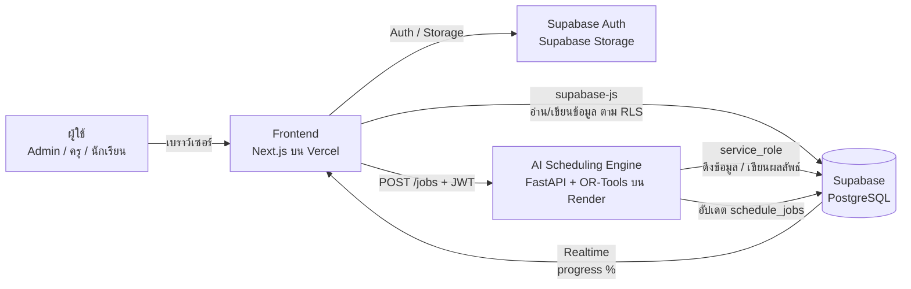

# ระบบจัดตารางเรียน-ตารางสอนอัตโนมัติ วิทยาลัยการอาชีพโพนทอง

เว็บแอปพลิเคชันจัดตารางเรียน/ตารางสอนด้วย AI (Constraint Programming) สำหรับสถานศึกษาอาชีวะ
**Frontend:** Next.js 14 + Tailwind CSS · **ฐานข้อมูล/BaaS:** Supabase (PostgreSQL, Auth, Storage, Realtime) · **AI Engine:** Python FastAPI + Google OR-Tools CP-SAT

---

## สารบัญ

1. [ภาพรวมสถาปัตยกรรม](#1-ภาพรวมสถาปัตยกรรม)
2. [ความสามารถของระบบ](#2-ความสามารถของระบบ)
3. [โครงสร้างโปรเจกต์](#3-โครงสร้างโปรเจกต์)
4. [ขั้นตอนการติดตั้งแบบละเอียด](#4-ขั้นตอนการติดตั้งแบบละเอียด)
   - [ขั้นที่ 0 เตรียมเครื่องมือและบัญชี](#ขั้นที่-0-เตรียมเครื่องมือและบัญชี)
   - [ขั้นที่ 1 นำโค้ดขึ้น GitHub](#ขั้นที่-1-นำโค้ดขึ้น-github)
   - [ขั้นที่ 2 สร้างโปรเจกต์ Supabase](#ขั้นที่-2-สร้างโปรเจกต์-supabase)
   - [ขั้นที่ 3 สร้างฐานข้อมูล (รัน SQL)](#ขั้นที่-3-สร้างฐานข้อมูล-รัน-sql)
   - [ขั้นที่ 4 ตั้งค่า Auth / Realtime / Storage](#ขั้นที่-4-ตั้งค่า-auth--realtime--storage)
   - [ขั้นที่ 5 ทดลองรันบนเครื่องตัวเอง](#ขั้นที่-5-ทดลองรันบนเครื่องตัวเอง-local)
   - [ขั้นที่ 6 สร้างผู้ดูแลระบบคนแรก](#ขั้นที่-6-สร้างผู้ดูแลระบบ-admin-คนแรก)
   - [ขั้นที่ 7 Deploy AI Engine ขึ้น Render](#ขั้นที่-7-deploy-ai-engine-ขึ้น-render)
   - [ขั้นที่ 8 Deploy หน้าเว็บขึ้น Vercel](#ขั้นที่-8-deploy-หน้าเว็บขึ้น-vercel)
   - [ขั้นที่ 9 เชื่อมทุกส่วนเข้าด้วยกัน](#ขั้นที่-9-เชื่อมทุกส่วนเข้าด้วยกัน)
5. [วิธีใช้งานระบบ](#5-วิธีใช้งานระบบ)
6. [การอัปเดตระบบผ่าน GitHub](#6-การอัปเดตระบบผ่าน-github)
7. [รายละเอียดฐานข้อมูล](#7-รายละเอียดฐานข้อมูล)
8. [อัลกอริทึมจัดตาราง](#8-อัลกอริทึมจัดตาราง)
9. [ความปลอดภัย](#9-ความปลอดภัย)
10. [แก้ปัญหาที่พบบ่อย](#10-แก้ปัญหาที่พบบ่อย)

---

## 1. ภาพรวมสถาปัตยกรรม



| ส่วน | หน้าที่ |
|---|---|
| **Frontend (Next.js)** | Dashboard, จัดการข้อมูลหลัก, นำเข้า CSV/Excel พร้อม Pre-check, สั่งจัดตาราง + แถบความคืบหน้าแบบเรียลไทม์, ตารางแบบลากวาง (Drag & Drop), ส่งออก Excel/PDF |
| **Supabase PostgreSQL** | Master Data + ผลลัพธ์ตาราง (ใช้ JSONB เก็บเงื่อนไข เช่น เวลาไม่สะดวกสอน, การตั้งค่าคาบ) |
| **Supabase Auth** | ล็อกอิน แบ่งสิทธิ์ `admin` / `teacher` / `student` + Row Level Security |
| **Supabase Storage** | bucket `imports` (ไฟล์ต้นฉบับที่นำเข้า) และ `exports` (ไฟล์ Excel ที่ส่งออก) |
| **Supabase Realtime** | ส่งสถานะ “กำลังคำนวณ xx%” จากตาราง `schedule_jobs` ไปยังหน้าเว็บทันที |
| **AI Engine (Python)** | แยกเป็น Microservice เพราะการคำนวณใช้เวลานานเกินขีดจำกัดของ Serverless Functions |

---

## 2. ความสามารถของระบบ

- ✅ จัดตารางอัตโนมัติ **ไม่ชนกัน 100%** ทั้ง ครู / กลุ่มนักเรียน / ห้อง
- ✅ ห้องต้องตรงประเภท (ทฤษฎี, ห้องคอมฯ, โรงฝึกงานช่างยนต์, ห้องปฏิบัติการไฟฟ้า ฯลฯ) และจุนักเรียนได้พอ
- ✅ วิชาปฏิบัติจัดเป็น **คาบต่อเนื่อง** (เช่น 1-6-3 = 7 คาบ → แบ่ง 4+3 คาบ อยู่คนละวัน) และไม่คร่อมพักเที่ยง
- ✅ เคารพ **เวลาที่ครูไม่สะดวกสอน** (ครูกรอกเองได้) และ **คาบที่ห้ามจัด** (เช่น กิจกรรมวันพุธบ่าย)
- ✅ **กลุ่มคู่ขนาน**: กลุ่มที่เรียนวิชาเดียวกันกับครูคนเดียวกันจัดให้เรียนรวมพร้อมกัน
- ✅ **ล็อกคาบ**: คาบที่ปรับด้วยมือจะถูกล็อก การจัดใหม่ครั้งต่อไปจะไม่ย้าย
- ✅ ตรวจสอบภาระงานก่อนคำนวณ (Pre-check) เช่น ครูสอนเกินเกณฑ์ ห้องประเภทที่ต้องใช้ไม่มี
- ✅ ปรับแก้ด้วยมือแบบ **ลากวาง** พร้อมเตือนการชนกันทันที / เปลี่ยนห้อง / ลบคาบ
- ✅ มุมมอง ตารางเรียน (กลุ่ม) / ตารางสอน (ครู) / ตารางการใช้ห้อง
- ✅ ฉบับร่าง → **เผยแพร่** (ครู/นักเรียนเห็นเฉพาะตารางที่เผยแพร่แล้ว)
- ✅ ส่งออก **Excel** (ทีละรายการ หรือทุกกลุ่ม/ทุกครู/ทุกห้อง แยกแท็บ) และ **พิมพ์/บันทึกเป็น PDF**

---

## 3. โครงสร้างโปรเจกต์

```
phonthong-timetable/
├── supabase/
│   ├── migrations/20251101000000_init_schema.sql   ← ตาราง, ฟังก์ชัน, RLS, Storage, Realtime
│   └── seed.sql                                     ← ข้อมูลตัวอย่าง (ภาคเรียน 1/2568)
├── engine/                       ← AI Scheduling Engine (Python FastAPI)
│   ├── app/
│   │   ├── main.py               ← API: POST /jobs, GET /health
│   │   ├── runner.py             ← โหลดข้อมูล → คำนวณ → บันทึกผล + รายงาน progress
│   │   ├── builder.py            ← แปลงข้อมูล, รวมกลุ่มคู่ขนาน, Pre-check
│   │   ├── solver.py             ← โมเดล CP-SAT (หัวใจของการจัดตาราง)
│   │   ├── db.py / config.py
│   ├── tests/test_solver.py      ← ชุดทดสอบ (pytest)
│   ├── Dockerfile, requirements.txt, .env.example
├── web/                          ← Frontend (Next.js 14 App Router)
│   ├── app/
│   │   ├── login/                ← เข้าสู่ระบบ / สมัครสมาชิก
│   │   └── (app)/
│   │       ├── page.tsx          ← Dashboard
│   │       ├── data/[entity]/    ← จัดการข้อมูลหลัก (ภาคเรียน ครู วิชา ห้อง กลุ่ม ภาระงานสอน)
│   │       ├── import/           ← นำเข้า CSV/Excel + Pre-check
│   │       ├── generate/         ← สั่ง AI จัดตาราง + Realtime progress
│   │       ├── timetable/        ← ตารางแบบลากวาง + ส่งออก
│   │       ├── availability/     ← ครูกำหนดเวลาไม่สะดวกสอน
│   │       └── users/            ← จัดการสิทธิ์ผู้ใช้
│   ├── components/, lib/
│   └── .env.example
├── sample-data/                  ← ไฟล์ CSV ตัวอย่างสำหรับทดลองนำเข้า
├── .github/workflows/ci.yml      ← GitHub Actions: ตรวจ build + รัน test ทุกครั้งที่ push
└── render.yaml                   ← ไฟล์ตั้งค่า deploy AI Engine บน Render
```

---

## 4. ขั้นตอนการติดตั้งแบบละเอียด

> ใช้บริการฟรีทั้งหมด: **GitHub** (เก็บโค้ด) · **Supabase** (ฐานข้อมูล) · **Vercel** (หน้าเว็บ) · **Render** (AI Engine)

### ขั้นที่ 0 เตรียมเครื่องมือและบัญชี

**บัญชีออนไลน์ (สมัครฟรี)**

| บริการ | ลิงก์ | หมายเหตุ |
|---|---|---|
| GitHub | https://github.com/signup | ใช้เก็บโค้ด |
| Supabase | https://supabase.com | กด *Start your project* → *Continue with GitHub* |
| Vercel | https://vercel.com/signup | เลือก *Continue with GitHub* |
| Render | https://render.com | เลือก *GitHub* ในการสมัคร |

**โปรแกรมบนเครื่อง (จำเป็นถ้าต้องการรันทดสอบบนเครื่อง / แก้ไขโค้ด)**

| โปรแกรม | เวอร์ชัน | ตรวจสอบด้วยคำสั่ง |
|---|---|---|
| [Git](https://git-scm.com/downloads) | ล่าสุด | `git --version` |
| [Node.js LTS](https://nodejs.org) | 20 ขึ้นไป | `node -v` |
| [Python](https://www.python.org/downloads/) | 3.12 (Windows: ติ๊ก *Add Python to PATH*) | `python --version` |
| [VS Code](https://code.visualstudio.com) | ล่าสุด | (แนะนำ) |

---

### ขั้นที่ 1 นำโค้ดขึ้น GitHub

1. เข้า https://github.com/new
2. ตั้งชื่อ Repository เช่น `phonthong-timetable` เลือก **Private** (แนะนำ) **ไม่ต้อง** ติ๊ก *Add a README* → กด **Create repository**
3. เปิด Terminal (Windows ใช้ *Git Bash* หรือ *PowerShell*) ที่โฟลเดอร์ `phonthong-timetable` แล้วรันทีละคำสั่ง
   (เปลี่ยน `YOUR-USERNAME` เป็นชื่อบัญชี GitHub ของท่าน)

```bash
cd phonthong-timetable
```

```bash
git init -b main
```

```bash
git add .
```

```bash
git commit -m "Initial commit: ระบบจัดตารางสอน วิทยาลัยการอาชีพโพนทอง"
```

```bash
git remote add origin https://github.com/YOUR-USERNAME/phonthong-timetable.git
```

```bash
git push -u origin main
```

> ถ้าถูกถามรหัสผ่าน ให้ใช้ **Personal Access Token** แทนรหัสผ่าน: GitHub → Settings → Developer settings → Personal access tokens → *Generate new token* (ติ๊กสิทธิ์ `repo`)
> หรือใช้โปรแกรม [GitHub Desktop](https://desktop.github.com) แทนการพิมพ์คำสั่ง: *File → Add local repository → Publish repository*

4. เปิดหน้า Repository บน GitHub จะเห็นไฟล์ทั้งหมด และแท็บ **Actions** จะเริ่มรัน CI (ตรวจ build + test) อัตโนมัติ

---

### ขั้นที่ 2 สร้างโปรเจกต์ Supabase

1. เข้า https://supabase.com/dashboard → **New project**
2. กรอกข้อมูล
   - **Name:** `phonthong-timetable`
   - **Database Password:** ตั้งรหัสที่คาดเดายาก แล้ว **จดเก็บไว้**
   - **Region:** `Southeast Asia (Singapore)` (ใกล้ไทยที่สุด เร็วที่สุด)
3. กด **Create new project** รอประมาณ 1–2 นาที
4. ไปที่ **Project Settings (รูปเฟือง) → API Keys** (หรือ *Data API*) แล้วจดค่า 3 ค่านี้

| ค่า | อยู่ที่ไหน | ใช้ที่ |
|---|---|---|
| **Project URL** เช่น `https://abcdxyz.supabase.co` | Project Settings → Data API | Frontend + Engine |
| **anon / public key** | API Keys → แท็บ *Legacy API Keys* → `anon` `public` | Frontend เท่านั้น |
| **service_role key** | API Keys → แท็บ *Legacy API Keys* → `service_role` `secret` | **Engine เท่านั้น — ห้ามเปิดเผย** |

> ⚠️ `service_role` ข้ามสิทธิ์ RLS ได้ทั้งหมด **ห้ามใส่ในโค้ด Frontend และห้าม commit ขึ้น GitHub**

---

### ขั้นที่ 3 สร้างฐานข้อมูล (รัน SQL)

**วิธี A — ผ่านหน้าเว็บ (ง่ายที่สุด แนะนำ)**

1. Supabase Dashboard → เมนูซ้าย **SQL Editor** → **New query**
2. เปิดไฟล์ `supabase/migrations/20251101000000_init_schema.sql` คัดลอก **ทั้งหมด** มาวาง → กด **Run** (Ctrl+Enter)
   ต้องขึ้น `Success. No rows returned`
3. (ไม่บังคับ แต่แนะนำสำหรับทดลอง) กด **New query** อีกครั้ง วางเนื้อหาไฟล์ `supabase/seed.sql` → **Run**
   จะได้ข้อมูลตัวอย่าง: ครู 12 คน, ห้อง 10 ห้อง, วิชา 18 วิชา, กลุ่มนักเรียน 6 กลุ่ม, ภาระงานสอน 40 รายการ
4. ตรวจสอบที่ **Table Editor** จะเห็นตาราง `semesters, subjects, teachers, rooms, student_groups, profiles, enrollments, schedules, schedule_jobs`

**วิธี B — ผ่าน Supabase CLI (สำหรับนักพัฒนา)**

```bash
npx supabase login
```

```bash
npx supabase init
```

```bash
npx supabase link --project-ref <PROJECT_REF>
```

```bash
npx supabase db push
```

(`<PROJECT_REF>` คือส่วนหน้าของ Project URL เช่น `abcdxyz`; ถ้า `supabase init` ถามว่าจะเขียนทับโฟลเดอร์หรือไม่ ให้ตอบไม่ต้องเขียนทับ migrations)

---

### ขั้นที่ 4 ตั้งค่า Auth / Realtime / Storage

**4.1 Authentication**

1. **Authentication → Sign In / Providers → Email** ต้องเปิด (Enabled) อยู่
2. ช่วงทดลอง ถ้ายังไม่อยากยืนยันอีเมล ให้ **ปิด** *Confirm email* (เปิดกลับเมื่อใช้งานจริง)
3. **Authentication → URL Configuration**
   - **Site URL:** `http://localhost:3000` (หลัง deploy ค่อยเปลี่ยนเป็น URL ของ Vercel ในขั้นที่ 9)
   - **Redirect URLs:** เพิ่ม `http://localhost:3000/**`

**4.2 Realtime** — ไฟล์ SQL เปิดให้อัตโนมัติแล้ว ตรวจสอบได้ที่ **Database → Publications → `supabase_realtime`** ต้องมีตาราง `schedule_jobs` ถูกติ๊กอยู่

**4.3 Storage** — ไฟล์ SQL สร้าง bucket ให้อัตโนมัติแล้ว ตรวจที่เมนู **Storage** ต้องเห็น `imports` และ `exports` (เป็น Private)

---

### ขั้นที่ 5 ทดลองรันบนเครื่องตัวเอง (Local)

เปิด Terminal 2 หน้าต่าง

**หน้าต่างที่ 1 — AI Engine (Python)**

```bash
cd engine
```

```bash
python -m venv .venv
```

เปิดใช้งาน virtual environment — macOS/Linux:

```bash
source .venv/bin/activate
```

Windows (PowerShell):

```bash
.venv\Scripts\Activate.ps1
```

```bash
pip install -r requirements.txt
```

คัดลอกไฟล์ตั้งค่า (Windows ใช้ `copy` แทน `cp`) แล้วแก้ไข `.env` ใส่ `SUPABASE_URL` และ `SUPABASE_SERVICE_ROLE_KEY`:

```bash
cp .env.example .env
```

```bash
pytest -q
```

ต้องขึ้น `4 passed` จากนั้นเปิด server:

```bash
uvicorn app.main:app --reload --port 8000
```

เปิด http://localhost:8000/health ต้องเห็น `{"ok":true,...}` (เอกสาร API อัตโนมัติอยู่ที่ http://localhost:8000/docs)

**หน้าต่างที่ 2 — Frontend (Next.js)**

```bash
cd web
```

```bash
npm install
```

คัดลอกไฟล์ตั้งค่าแล้วแก้ `.env.local` ใส่ `NEXT_PUBLIC_SUPABASE_URL`, `NEXT_PUBLIC_SUPABASE_ANON_KEY` และ `NEXT_PUBLIC_ENGINE_URL=http://localhost:8000`:

```bash
cp .env.example .env.local
```

```bash
npm run dev
```

เปิด http://localhost:3000

---

### ขั้นที่ 6 สร้างผู้ดูแลระบบ (Admin) คนแรก

1. ที่หน้า http://localhost:3000/login กด **สมัครสมาชิก** กรอกชื่อ อีเมล รหัสผ่าน
2. ผู้สมัครใหม่จะได้สิทธิ์ `student` โดยอัตโนมัติ ให้ไปที่ Supabase → **SQL Editor** รันคำสั่ง (เปลี่ยนอีเมล):

```sql
update public.profiles set role = 'admin' where email = 'อีเมลของท่าน@example.com';
```

3. รีเฟรชหน้าเว็บ จะเห็นเมนูผู้ดูแลระบบครบ ผู้ใช้คนต่อไปสามารถกำหนดสิทธิ์ได้จากเมนู **จัดการผู้ใช้** ในเว็บ

> 💡 ครูที่สมัครด้วยอีเมลเดียวกับคอลัมน์ `email` ในข้อมูลครู จะได้สิทธิ์ `teacher` และถูกผูกกับข้อมูลครูอัตโนมัติ

---

### ขั้นที่ 7 Deploy AI Engine ขึ้น Render

**วิธี A — Blueprint (อัตโนมัติจากไฟล์ `render.yaml`)**

1. https://dashboard.render.com → **New → Blueprint**
2. เชื่อม GitHub แล้วเลือก repo `phonthong-timetable` → **Connect**
3. Render จะอ่าน `render.yaml` และถามค่าตัวแปร ให้กรอก
   - `SUPABASE_URL` = Project URL
   - `SUPABASE_SERVICE_ROLE_KEY` = service_role key
   - `ALLOWED_ORIGINS` = `http://localhost:3000` (เพิ่มโดเมน Vercel ภายหลังในขั้นที่ 9)
4. กด **Apply** รอ build ประมาณ 3–5 นาที

**วิธี B — สร้างเอง**

1. **New → Web Service** → เลือก repo
2. ตั้งค่า: **Root Directory** = `engine`, **Runtime** = `Docker`, **Instance Type** = Free
3. **Environment Variables** ใส่ 3 ค่าเหมือนวิธี A + `SOLVER_WORKERS=2`
4. **Advanced → Health Check Path** = `/health` → **Create Web Service**

เมื่อเสร็จจะได้ URL เช่น `https://phonthong-timetable-engine.onrender.com` เปิด `/health` เพื่อทดสอบ

> ℹ️ Render แบบฟรีจะ “หลับ” เมื่อไม่มีการใช้งาน 15 นาที การกดจัดตารางครั้งแรกอาจรอ 30–60 วินาทีให้เครื่องตื่น ถ้าต้องการให้พร้อมตลอดให้ใช้แผน Starter
> ทางเลือกอื่น: Railway, Fly.io, VPS ของวิทยาลัย (รัน `docker build -t engine ./engine && docker run -p 8000:8000 --env-file engine/.env engine`)
> ⚠️ ถ้าใช้ Google Cloud Run ต้องตั้ง *CPU always allocated* เพราะ Engine คำนวณใน background thread หลังตอบ HTTP แล้ว

---

### ขั้นที่ 8 Deploy หน้าเว็บขึ้น Vercel

1. https://vercel.com/new → **Import Git Repository** → เลือก `phonthong-timetable` → **Import**
2. ตั้งค่า
   - **Framework Preset:** Next.js (ตรวจพบอัตโนมัติ)
   - **Root Directory:** กด *Edit* → เลือก **`web`** ⚠️ สำคัญมาก
3. เปิด **Environment Variables** ใส่

| Name | Value |
|---|---|
| `NEXT_PUBLIC_SUPABASE_URL` | Project URL ของ Supabase |
| `NEXT_PUBLIC_SUPABASE_ANON_KEY` | anon public key |
| `NEXT_PUBLIC_ENGINE_URL` | URL ของ Render เช่น `https://phonthong-timetable-engine.onrender.com` (ไม่มี `/` ท้าย) |

4. กด **Deploy** รอ 1–2 นาที จะได้ URL เช่น `https://phonthong-timetable.vercel.app`

---

### ขั้นที่ 9 เชื่อมทุกส่วนเข้าด้วยกัน

1. **Render** → Service ของ Engine → **Environment** → แก้ `ALLOWED_ORIGINS` เป็น
   `http://localhost:3000,https://phonthong-timetable.vercel.app` → **Save Changes** (ระบบจะ redeploy ให้)
2. **Supabase → Authentication → URL Configuration**
   - **Site URL:** `https://phonthong-timetable.vercel.app`
   - **Redirect URLs:** เพิ่ม `https://phonthong-timetable.vercel.app/**`
3. เปิดเว็บบน Vercel → ล็อกอินด้วยบัญชี admin → เมนู **จัดตารางอัตโนมัติ (AI)** → กด **▶ เริ่มจัดตาราง**
   ถ้าเห็นแถบความคืบหน้าวิ่งจนถึง 100% แสดงว่าติดตั้งครบสมบูรณ์ 🎉

**Checklist**

- [ ] รัน `init_schema.sql` สำเร็จ (และ `seed.sql` ถ้าต้องการข้อมูลตัวอย่าง)
- [ ] มีผู้ใช้ role = `admin` อย่างน้อย 1 คน
- [ ] Render `/health` ตอบ `ok: true`
- [ ] Vercel มี Environment Variables ครบ 3 ค่า และ Root Directory = `web`
- [ ] `ALLOWED_ORIGINS` มีโดเมน Vercel
- [ ] Supabase Site URL เป็นโดเมน Vercel

---

## 5. วิธีใช้งานระบบ

**ลำดับการเตรียมข้อมูล** (เมนู *นำเข้าข้อมูล* หรือเพิ่มทีละรายการที่เมนู *ข้อมูลหลัก*)

| ลำดับ | ข้อมูล | ไฟล์ตัวอย่าง |
|---|---|---|
| 1 | ภาคเรียน (ตั้งเป็น “ภาคเรียนปัจจุบัน”) | — |
| 2 | ครูผู้สอน | `sample-data/01_teachers.csv` |
| 3 | ห้องเรียน | `sample-data/02_rooms.csv` |
| 4 | รายวิชา | `sample-data/03_subjects.csv` |
| 5 | กลุ่มนักเรียน | `sample-data/04_student_groups.csv` |
| 6 | ภาระงานสอน (กลุ่ม + วิชา + ครู) | `sample-data/05_enrollments.csv` |

- ไฟล์ CSV ต้องเป็น **UTF-8** (Excel: *Save As → CSV UTF-8*) หรืออัปโหลด **.xlsx** ได้โดยตรง (แถวแรกเป็นหัวคอลัมน์)
- ระบบ **Pre-check** ก่อนบันทึก: แสดงแถวใหม่ / ซ้ำในระบบ / ซ้ำในไฟล์ / ผิดพลาด (เช่น ไม่พบรหัสครู) เลือกได้ว่าจะข้ามหรืออัปเดตทับรายการซ้ำ
- คอลัมน์ `unavailable_times` ของครูเขียนแบบย่อได้ เช่น `1:1-2;5:5-8` = จันทร์คาบ 1–2 และศุกร์คาบ 5–8
- `block_sizes` ของภาระงานสอน เช่น `4,3` = แบ่ง 7 คาบเป็น 4 คาบ + 3 คาบ (เว้นว่าง = อัตโนมัติ ก้อนละไม่เกิน 4 คาบ)

**ตั้งค่าคาบเรียน** — เมนู *ภาคเรียน → แก้ไข → ตั้งค่าคาบเรียน (JSON)*

```json
{
  "days": [1, 2, 3, 4, 5],
  "periods": [
    {"no": 1, "start": "08:00", "end": "09:00"}, {"no": 2, "start": "09:00", "end": "10:00"},
    {"no": 3, "start": "10:00", "end": "11:00"}, {"no": 4, "start": "11:00", "end": "12:00"},
    {"no": 5, "start": "13:00", "end": "14:00"}, {"no": 6, "start": "14:00", "end": "15:00"},
    {"no": 7, "start": "15:00", "end": "16:00"}, {"no": 8, "start": "16:00", "end": "17:00"}
  ],
  "lunch_after_period": 4,
  "blocked": [{"day": 3, "periods": [7, 8], "label": "กิจกรรมชมรม/ลูกเสือ"}],
  "max_periods_per_day_group": 8
}
```

(`day`: 1 = จันทร์ … 5 = ศุกร์, 6 = เสาร์, 7 = อาทิตย์ — ถ้ามีเรียนวันเสาร์ให้เพิ่ม 6 ใน `days`)

**จัดตาราง → ตรวจ → เผยแพร่**

1. เมนู **จัดตารางอัตโนมัติ (AI)** → เลือกภาคเรียน → กำหนดเวลาคำนวณ (60 วินาทีเพียงพอสำหรับวิทยาลัยขนาดกลาง) → **เริ่มจัดตาราง**
2. ดูความคืบหน้าแบบเรียลไทม์ ถ้าไม่สำเร็จระบบจะแสดงสาเหตุ (เช่น ไม่มีห้องคอมฯ ที่จุได้ 40 คน)
3. เมนู **ตารางเรียน/ตารางสอน** → เลือกมุมมอง กลุ่ม/ครู/ห้อง
   - **ลากการ์ดวิชา** ไปวางช่องใหม่ ระบบตรวจการชนกันทันที (คาบที่ย้ายด้วยมือจะถูก 🔒 ล็อก)
   - **คลิกการ์ด** เพื่อเปลี่ยนห้อง / ล็อก-ปลดล็อก / ลบ
   - กด **จัดตารางใหม่** ได้ทุกเมื่อ คาบที่ล็อกไว้จะคงเดิม
4. กด **เผยแพร่ตาราง** → ครูและนักเรียนจึงจะเห็น
5. **ส่งออก Excel** (ไฟล์เก็บสำเนาใน Storage `exports` ด้วย) หรือ **พิมพ์ / PDF** (เลือก *Save as PDF* ในหน้าพิมพ์ แนวนอน A4)

---

## 6. การอัปเดตระบบผ่าน GitHub

เมื่อแก้ไขโค้ดแล้ว:

```bash
git add .
```

```bash
git commit -m "อธิบายสิ่งที่แก้ไข"
```

```bash
git push
```

- **GitHub Actions** ตรวจ build + test อัตโนมัติ (ดูที่แท็บ *Actions*)
- **Vercel** และ **Render** จะ deploy เวอร์ชันใหม่ให้อัตโนมัติภายในไม่กี่นาที
- ถ้าแก้โครงสร้างฐานข้อมูล ให้สร้างไฟล์ใหม่ใน `supabase/migrations/` (ตั้งชื่อขึ้นต้นด้วยวันเวลา) แล้วรันใน SQL Editor หรือ `npx supabase db push`

---

## 7. รายละเอียดฐานข้อมูล

ต่อยอดจากโครงสร้างตัวอย่าง โดยเพิ่มส่วนที่จำเป็นต่อการใช้งานจริง

| ตาราง | คอลัมน์หลัก | หมายเหตุ / ส่วนที่เพิ่ม |
|---|---|---|
| `profiles` | `id`(=auth.users.id), `email`, `full_name`, `role`, `student_group_id` | ทำหน้าที่ตาราง `users` ในแบบร่าง (ใช้ชื่อ profiles เพื่อไม่ให้สับสนกับ `auth.users` ของ Supabase) สร้างอัตโนมัติด้วย trigger เมื่อสมัคร |
| `semesters` | `academic_year`, `term`, `name`(เช่น 1/2568), `is_active`, `config` (JSONB) | **เพิ่ม** เพื่อแยกตารางแต่ละภาคเรียน และเก็บการตั้งค่าคาบ/คาบห้ามจัด |
| `subjects` | `subject_code`, `subject_name`, `theory_hours`, `lab_hours`, `credits`, `required_room_type` | |
| `teachers` | `user_id`, `teacher_code`, `name`, `email`, `max_hours_per_week`, `unavailable_times` (JSONB) | `unavailable_times` = `[{"day":1,"periods":[1,2]}]` |
| `rooms` | `room_code`, `room_name`, `room_type`, `capacity` | |
| `student_groups` | `group_code`, `group_name`, `department`, `level`, `student_count`, `is_parallel`, `parallel_ref_id` | **เพิ่ม** `student_count` สำหรับตรวจความจุห้อง |
| `enrollments` | `semester_id`, `student_group_id`, `subject_id`, `teacher_id`, `total_hours_required`, `block_sizes`, `preferred_room_id` | `total_hours_required` เติมอัตโนมัติจาก ท+ป |
| `schedules` | `enrollment_id`, `room_id`, `day_of_week`, `start_period`, `end_period`, `status`, `is_locked`, `session_key` | **เพิ่ม** `is_locked` (ล็อกคาบ) และ `session_key` (แถวของกลุ่มคู่ขนานที่เรียนรวมใช้ key เดียวกัน) |
| `schedule_jobs` | `status`, `progress`, `message`, `result` (JSONB) | **เพิ่ม** สำหรับ Realtime progress และประวัติการจัด |
| view `schedule_details` | รวมข้อมูลตาราง + วิชา + ครู + กลุ่ม + ห้อง | ใช้แสดงผล (เคารพ RLS) |

**สิทธิ์ (Row Level Security)**

| | Admin | ครู | นักเรียน |
|---|---|---|---|
| อ่านข้อมูลหลัก | ✅ | ✅ | ✅ |
| แก้ไขข้อมูลหลัก | ✅ | ❌ (แก้ได้เฉพาะเวลาไม่สะดวกสอนของตนเอง) | ❌ |
| ตารางฉบับร่าง | ✅ อ่าน/แก้ | ❌ | ❌ |
| ตารางที่เผยแพร่แล้ว | ✅ | ✅ อ่าน | ✅ อ่าน |
| สั่ง AI จัดตาราง | ✅ | ❌ | ❌ |

---

## 8. อัลกอริทึมจัดตาราง

ใช้ **Constraint Programming (Google OR-Tools CP-SAT)** ซึ่งรับประกันว่าผลลัพธ์ไม่ละเมิดเงื่อนไขบังคับ (ต่างจาก GA ที่อาจได้คำตอบที่ยังชนกันอยู่)

1. **Pre-check** (`builder.py`) — แบ่งชั่วโมงเป็นก้อนคาบต่อเนื่อง, รวมกลุ่มคู่ขนาน, ตรวจภาระครู/กลุ่มเกินเวลาที่มี
2. **ตัวแปร** — `x[ก้อนคาบ, วัน, คาบเริ่ม, ห้อง] ∈ {0,1}` สร้างเฉพาะตำแหน่งที่เป็นไปได้ (ห้องตรงประเภทและจุพอ, ครูว่าง, ไม่ทับคาบห้ามจัด/คาบที่ล็อก, ไม่คร่อมพักเที่ยง)
3. **เงื่อนไขบังคับ** — ทุกก้อนคาบถูกวาง 1 ตำแหน่ง; ในแต่ละคาบ ครู/กลุ่ม/ห้อง ถูกใช้ได้ไม่เกิน 1 ครั้ง
4. **เป้าหมาย (ลดคะแนนโทษ)** — ก้อนของวิชาเดียวกันควรอยู่ต่างวัน (×20), คาบต่อวันของกลุ่มไม่เกินกำหนด (×10), เลี่ยงคาบสุดท้ายของวัน (×1)
5. ระหว่างค้นหา Engine เขียนความคืบหน้าลง `schedule_jobs` ทุก ~2 วินาที → Realtime → หน้าเว็บ

ปรับน้ำหนัก/เพิ่มเงื่อนไขได้ที่ `engine/app/solver.py` (เช่น ครูไม่ควรสอนเกิน 6 คาบต่อวัน, วิชาสามัญควรอยู่ช่วงเช้า)

---

## 9. ความปลอดภัย

- Frontend ใช้เฉพาะ **anon key** + session ของผู้ใช้ สิทธิ์ทั้งหมดควบคุมด้วย **RLS** ในฐานข้อมูล
- **service_role key** อยู่เฉพาะใน Environment Variables ของ Engine (Render) เท่านั้น
- Engine ตรวจ JWT ของผู้เรียกกับ Supabase Auth และยอมให้เฉพาะ `admin` สั่งจัดตาราง
- Engine รับคำขอเฉพาะจากโดเมนที่ระบุใน `ALLOWED_ORIGINS` (CORS)
- ไฟล์ `.env`, `.env.local` อยู่ใน `.gitignore` แล้ว — ตรวจด้วย `git status` ก่อน push ทุกครั้ง
- ใช้งานจริงควรเปิด *Confirm email* และตั้งรหัสผ่านขั้นต่ำใน Supabase Auth

---

## 10. แก้ปัญหาที่พบบ่อย

| อาการ | สาเหตุ / วิธีแก้ |
|---|---|
| ล็อกอินแล้วเมนูมีแค่ “หน้าหลัก/ตาราง” | บัญชียังเป็น `student` → รันคำสั่ง SQL ในขั้นที่ 6 |
| `เรียก AI Engine ไม่สำเร็จ ... Failed to fetch` | `NEXT_PUBLIC_ENGINE_URL` ผิด / Engine ยังหลับ (รอ 1 นาทีแล้วลองใหม่) / `ALLOWED_ORIGINS` ไม่มีโดเมนเว็บ |
| Engine ตอบ `401 token ไม่ถูกต้อง` | `SUPABASE_URL` ของ Engine กับ Frontend เป็นคนละโปรเจกต์ หรือ session หมดอายุ (ล็อกอินใหม่) |
| Engine ตอบ `403 เฉพาะผู้ดูแลระบบ` | ผู้ใช้ไม่ใช่ admin |
| แถบความคืบหน้าไม่ขยับแต่สุดท้ายสำเร็จ | Realtime ยังไม่เปิดสำหรับ `schedule_jobs` (ดูขั้นที่ 4.2) — ระบบมี polling สำรองทุก 3 วินาที |
| `PRECHECK_FAILED: ไม่มีห้องประเภท ...` | เพิ่มห้องประเภทนั้น หรือห้องที่จุนักเรียนได้มากพอ (กลุ่มคู่ขนานเรียนรวมจะรวมจำนวนนักเรียน) |
| `INFEASIBLE` | เงื่อนไขขัดกัน เช่น ครูมีภาระสอนมากกว่าเวลาว่าง, ห้องประเภทเดียวมีน้อยเกินไปสำหรับชั่วโมงปฏิบัติรวม |
| `UNKNOWN` (หาคำตอบไม่ทัน) | เพิ่มเวลาคำนวณ หรือเพิ่ม `SOLVER_WORKERS` / ใช้เครื่องที่แรงขึ้น |
| นำเข้า CSV แล้วภาษาไทยเพี้ยน | บันทึกไฟล์เป็น **CSV UTF-8** หรืออัปโหลดเป็น .xlsx |
| Vercel build error `Couldn't find any pages` | ยังไม่ได้ตั้ง Root Directory = `web` |
| ครูไม่เห็นตารางของตนเอง | ตารางยังไม่ได้ “เผยแพร่” หรือบัญชียังไม่ได้ผูกกับข้อมูลครู (เมนูจัดการผู้ใช้) |

---

<sub>ข้อมูลใน `seed.sql` และ `sample-data/` (ชื่อครู รหัสวิชา) เป็นข้อมูลสมมติเพื่อทดสอบระบบ กรุณาแทนที่ด้วยข้อมูลจริงของวิทยาลัย</sub>
